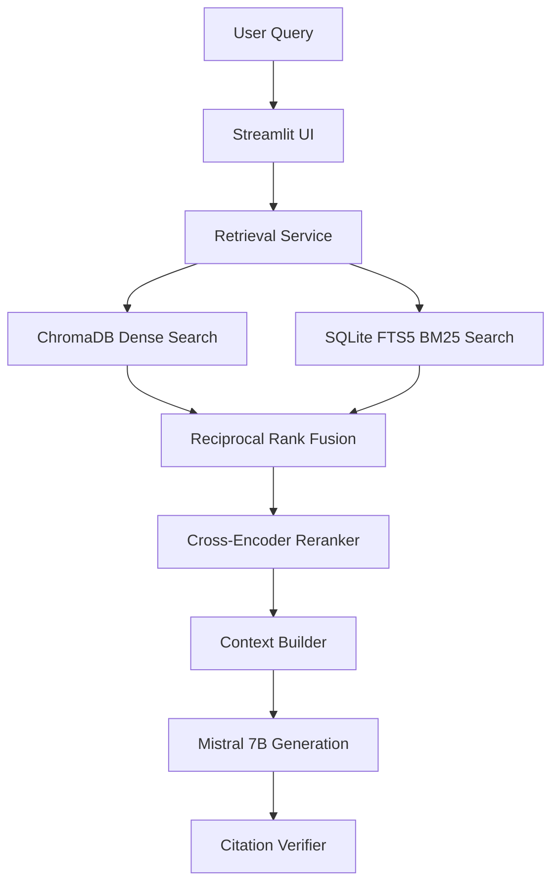

# NyayaSahayak — Privacy-Preserving Legal AI Assistant for India

> **The Problem:** Legal research takes hours of manual reading, and cloud-based AI tools (ChatGPT, LexisNexis AI) leak sensitive client facts to third-party servers — violating attorney-client privilege. Indian law firms structurally reject these tools.
>
> **The Solution:** NyayaSahayak is a 100% offline, zero-data-egress legal research assistant. It searches 26,557 Supreme Court of India judgments (1950–2025) in seconds, running entirely on local hardware. The corpus, embeddings, LLM weights, and chat history never leave the machine. It describes what courts have held. It does not tell you what to do.

## Impact & Value Proposition

- **Time compression:** Reduces manual statutory and case-law lookup from ~45 minutes to < 3 seconds per query.
- **Compliance by architecture:** Zero data egress ensures strict adherence to attorney-client privilege and data-localization requirements — there is no server that could see the data, because there is no server.
- **Hallucination guardrails:** A 3-layer safety system (context-bound generation, empty-retrieval gating, deterministic post-hoc citation verification) ensures every claim is traceable to a downloadable source PDF.

---

## Architecture



---

## Corpus Statistics

| Metric | Value |
| --- | --- |
| Total documents processed | 26,688 |
| Documents after quality filtering | 26,557 |
| Total embedded chunks | 935,605 |
| Average chunks per judgment | 35.13 |
| Date range | 1950–2025 |
| Excluded (no JUDGMENT marker) | 55 |
| Excluded (too short, <500 chars) | 76 |

---

## Technology Stack

| Component | Technology | Purpose |
| --- | --- | --- |
| Embedding model | `multi-qa-mpnet-base-dot-v1` (768-dim) | Dense vector retrieval |
| Keyword index | SQLite FTS5 (porter stemmer) | BM25 lexical search |
| Reranker | `cross-encoder/ms-marco-MiniLM-L-6-v2` | Precision reranking |
| LLM | Mistral 7B Instruct (Q5_K_M / Q4_K_M GGUF) | Answer generation |
| Vector DB | ChromaDB (persistent, cosine) | Dense vector storage |
| UI | Streamlit | Chat interface |
| LLM runtime | `llama-cpp-python` | Local GGUF inference |
| MLOps / CI-CD | Docker, GitHub Actions, pytest | Containerization & automated testing |

---

## Retrieval Pipeline

1. **Dense Search:** The query is encoded with `multi-qa-mpnet-base-dot-v1` (768-dim) and matched against 935,605 embedded chunks in ChromaDB using cosine similarity. Returns top 80 candidates.
2. **Keyword Search:** The query is tokenized and matched against an SQLite FTS5 index using BM25 with a porter stemmer. This catches exact statute references ("Section 302 IPC", "Article 21") that dense search misses. Returns top 80 candidates.
3. **Reciprocal Rank Fusion (RRF):** Both result lists are merged using RRF (k=60). Chunks found by both retrievers receive higher scores. Produces a fused list of ~120–140 candidates.
4. **Cross-Encoder Reranking:** The top 40 fused candidates are reranked using `cross-encoder/ms-marco-MiniLM-L-6-v2`, which reads (query, passage) pairs and scores true relevance. Final top 6–8 are returned.

**Why hybrid?** Pure dense search fails on exact legal references. Pure keyword search fails on semantic queries like "can a lunatic inherit property under Hindu law?" Hybrid search covers both failure modes.

---

## Data Pipeline

### Phase 1: PDF Cleaning
- 26,688 PDFs extracted using `pypdf`
- Judgment text isolated by detecting `JUDGMENT:` / `ORDER:` markers
- Headnotes and publisher metadata removed (legal integrity — headnotes are not the judge's words)
- Porter-stemmed FTS5 index built for keyword retrieval
- Quality flags applied: 55 no-marker documents and 76 too-short documents excluded

### Phase 2: Ingestion
- Cleaned chunks embedded with `multi-qa-mpnet-base-dot-v1` (768-dim)
- Stored in ChromaDB with cosine distance metric
- SQLite FTS5 index built with `porter unicode61` tokenizer
- Metadata stored: `case_name`, `judgment_date`, `source_file`, `chunk_index`, `doc_id`

---

## Evaluation

Tested against a **25-query ground-truth benchmark** spanning constitutional, criminal, criminal-procedure, personal, and commercial law.

| Metric | Value |
| --- | --- |
| Recall@5 | 76.0% |
| Recall@10 | 88.0% |
| Recall@20 | 92.0% |
| Mean Reciprocal Rank (MRR) | 0.686 |
| Median retrieval latency | ~1.5s warm / ~26s cold-start (model load) |

> Metrics above use the lenient token-overlap matcher. A strict matcher (SequenceMatcher ratio ≥ 0.9) is also implemented in `scripts/tests/run_evaluation.py` and reports both scores side-by-side in `eval_results.json`.

**Known retrieval limitations:**
- **Headnote stripping:** Queries phrased in exact publisher headnote language may suffer lower recall, as headnotes are intentionally stripped during ingestion so the LLM only reasons over the judge's actual words.
- **Corpus boundaries:** Pre-1950 Privy Council or Federal Court rulings are only accessible via citations within post-1950 judgments, not as primary documents.
- **Pre-1990 OCR artifacts:** Dense retrieval struggles with archaic legal language and OCR noise in older PDFs.

---

## Legal Safety & Guardrails

NyayaSahayak is **not a lawyer**. This is enforced at multiple layers:

1. **System prompt:** The LLM is instructed: *"You are NOT a lawyer. You do NOT provide legal advice. NEVER use prescriptive language like 'you should', 'you must', 'file a petition'."*
2. **Empty-retrieval gating:** If the hybrid retriever returns zero relevant authorities, generation halts and the user is explicitly informed rather than receiving a hallucinated answer.
3. **Context-bound generation:** The LLM only receives retrieved judgment passages. It cannot cite cases that were not retrieved.
4. **Citation verification:** Post-generation, every case name in the answer is cross-checked against retrieved metadata; hallucinated citations are flagged.
5. **Source transparency:** Every answer includes source cards with the full judgment PDF available for download, so the user can verify everything independently.
6. **Mandatory disclaimer:** Displayed on every screen and appended to every answer.

---

## Setup & Installation

### Prerequisites
- Python 3.10+ (3.10.11 used for development)
- NVIDIA GPU with 8GB+ VRAM (RTX 4060 or equivalent recommended)
- CUDA 12.1
- 16GB+ RAM, 50GB+ disk space

### 📦 Pre-Built Asset Downloads

To skip building the vault and downloading models manually, download the pre-built assets. All assets are open-weight/open-data and free for research use.

| Asset | Size | Description |
| --- | --- | --- |
| Models Bundle | ~10 GB | Mistral 7B Q4_K_M + Q5_K_M GGUF |
| Vault Bundle | ~5 GB | Pre-built ChromaDB + SQLite FTS5 index |
| Demo PDFs | ~20 MB | 30 judgment PDFs for eval & demo |
| Full Corpus PDFs | ~20 GB | All 26,557 judgment PDFs (optional) |
| Checksums | 1 KB | SHA-256 hashes for integrity verification |

**Google Drive download link:** https://drive.google.com/drive/folders/1YoxwDNZ_NML7sfPAeLhB8jDWXbdPtfYY?usp=sharing

⚡ **Quick Start (< 5 minutes):** Download Models + Vault + Demo PDFs only. You will have a fully working legal research assistant with downloadable judgments.

### Quick Start with Bundles (Bare Metal)

```bash
git clone https://github.com/DataWiseWizard/nyaya-sahayak.git
cd nyaya-sahayak
python -m venv venv
source venv/bin/activate   # Windows: venv\Scripts\activate

# 1. Extract models  -> place mistral-7b-instruct-q5.gguf / q4.gguf into models/
# 2. Extract vault    -> place chroma/ and nyaya_keyword_porter.db into vault/
# 3. Extract demo PDFs -> place all PDFs into docs/judgments/

# 4. Install dependencies
pip install -r requirements.txt
pip install llama-cpp-python --extra-index-url https://abetlen.github.io/llama-cpp-python/whl/cu121

# 5. Run
streamlit run app.py
```

The first launch takes 30–60 seconds to load all models into GPU memory. Subsequent queries stream in real time.

### 🐳 Docker & MLOps (CI/CD)

The repository includes a production-ready `Dockerfile`, `docker-compose.yml`, and a GitHub Actions CI/CD pipeline that auto-builds and pytest-validates the container on Linux runners.

> **Note:** Local development is performed on bare metal to avoid known WSL2/Docker Desktop AVX virtualization incompatibilities with CUDA-compiled ML wheels. The containerized image targets native Linux GPU servers or enterprise on-premise infrastructure.

```bash
# Build and run the container
docker compose build
docker compose up

# Run the test suite inside the container
docker compose run --rm --entrypoint "" nyaya-sahayak python -m pytest scripts/tests/test_core.py -v
```

### Testing & Evaluation (Bare Metal)

```bash
# Unit tests
python -m pytest scripts/tests/test_core.py -v

# Retrieval benchmark (writes eval_results.json)
python scripts/tests/run_evaluation.py
```

---

## Distribution Strategy (Roadmap)

To make NyayaSahayak accessible to non-technical users (law students, legal-aid clinics) without requiring Python or Docker knowledge, the project is architected for multi-tier distribution:

1. **Desktop Application:** Packaging the Streamlit UI and local inference engine via PyInstaller + pywebview into a single `.exe` / `.dmg` installer with a first-run model download manager.
2. **Portable USB Edition:** A pre-configured embedded-Python environment on a USB drive for air-gapped use on any library or courtroom computer with zero installation.
3. **On-Premise Enterprise:** Docker/Kubernetes deployment for law-firm internal networks with SSO and audit logging.

---

## Project Structure

```text
nyaya-sahayak/
 ├── app.py                          # Streamlit UI
 ├── backend/
 │   ├── retrieval_service.py        # Hybrid retrieval (ChromaDB + FTS5 + RRF + rerank)
 │   ├── context_builder.py          # Formats context for LLM
 │   ├── generation_service.py       # Mistral 7B streaming generation
 │   ├── citation_verifier.py        # Hallucination detection
 │   └── ocr.py                      # Tesseract OCR for uploads
 ├── scripts/
 │   ├── data_prep/
 │   │   ├── clean_dataset_v2.py     # PDF cleaning pipeline
 │   │   ├── build_quality_flags.py  # Quality filtering
 │   │   └── audit_cleaning.py       # Cleaning audit
 │   ├── ingestion/
 │   │   ├── ingest_chroma.py        # ChromaDB vector ingestion
 │   │   ├── build_keyword_index.py  # SQLite FTS5 index builder
 │   │   └── resume_ingest.py        # Resumable ingestion
 │   └── tests/
 │       ├── test_core.py            # Pytest unit suite
 │       ├── eval_dataset.jsonl      # 25-query ground-truth benchmark
 │       └── run_evaluation.py       # Recall@K / MRR evaluation runner
 ├── .github/workflows/ci.yml        # GitHub Actions: lint + pytest + docker build
 ├── Dockerfile                      # CUDA 12.1 production container
 ├── docker-compose.yml              # Local container orchestration
 ├── pytest.ini                      # Test markers (integration vs unit)
 ├── models/                         # GGUF model weights
 ├── vault/                          # ChromaDB + SQLite FTS5 data
 ├── docs/judgments/                 # Source judgment PDFs
 ├── data/cleaned/                   # Cleaned JSONL chunks
 ├── requirements.txt
 └── README.md
```

---

## License

MIT License — free to use, modify, and distribute.

## Disclaimer

NyayaSahayak is a legal research assistant. It is **not a lawyer** and does **not** provide legal advice. The information presented is for research and educational purposes only. Always consult a qualified advocate for legal matters.